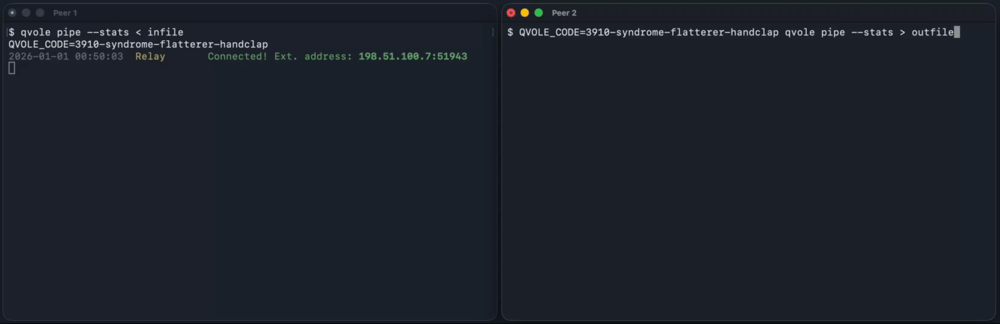

<p align="center"></p>

<h1 align="center">qvole</h1>
<p align="center">
  <a href="https://go.dev"></a>
  <a href="https://github.com/fernjager/qvole/actions/workflows/ci.yml"></a>
  <a href="../../LICENSE"></a>
</p>
<p align="center"><em>Быстрые туннели на QUIC, пробивающиеся сквозь NAT.</em></p>

<p align="center">
  <a href="../../README.md">English</a> &nbsp;|&nbsp;
  <a href="./README.zh-CN.md">简体中文</a> &nbsp;|&nbsp;
  <a href="./README.zh-TW.md">繁體中文</a> &nbsp;|&nbsp;
  <a href="./README.es.md">Español</a> &nbsp;|&nbsp;
  <a href="./README.ru.md">Русский</a>
</p>

Две машины - обе за NAT. Поделитесь коротким кодом со своим собеседником, и между вами будет зашифрованный канал.

Пробрасывайте порты, передавайте файлы, запускайте удалённые команды и каналы (pipes). Один бинарный файл - без конфигурационных файлов и настройки.

<p align="center"></p>

---

## Примеры быстрого старта

См. [примеры](#каналы) ниже - там ещё больше идей!

```bash
# Отправить файл
alice$ qvole pipe < in                         # печатает код подключения и ждёт bob
bob$   QVOLE_CODE=CODE qvole pipe > out        # bob подключается и получает файл от alice

# Отправить директорию
alice$ tar czf - dir/ | qvole pipe             # alice передаёт tar-архив dir/ для bob
bob$   QVOLE_CODE=CODE qvole pipe | tar xzf -  # bob получает и распаковывает dir/

# Проброс портов
alice$ qvole tunnel \
    -L 8080:localhost:80 \
    -R 2222:localhost:22
# bob разрешает запросы туннеля
bob$   QVOLE_CODE=CODE qvole tunnel \
    -aF localhost:80 \
    -aL 127.0.0.1:2222
alice$ curl localhost:8080    # попадает на :80 машины bob
bob$   ssh -p 2222 localhost  # попадает на sshd машины alice

# Удалённая команда (alice запускает команду, bob подключается)
alice$ qvole exec --cmd "uptime"                    # выполняется на alice, bob видит вывод
alice$ qvole exec --cmd "script -q bash /dev/null"  # alice даёт bob удалённую оболочку
bob$   QVOLE_CODE=CODE qvole exec

# Запуск собственного relay-сервера (UDP)
relay$ qvole relay --listen :9009
```

---

## Установка

**Одной командой через curl:**

```bash
curl -fsSL https://get.qvole.dev | sh
```

**Из исходников:**

```bash
git clone https://github.com/fernjager/qvole && cd qvole && make && sudo make install
```

(Требуется Go 1.27+)

---

## Проблема

Я запускаю сервисы повсюду: домашний сервер (homelab), VPS, дорожный роутер с сотовой SIM-картой на паруснике.
Обычные варианты (VPN, обратные SSH-туннели, проброс портов) требуют сертификатов, распространения ключей
или доступных снаружи портов. Каждый открытый порт - потенциальная уязвимость нулевого дня,
а личный сервер, который в лучшем случае обновляется от случая к случаю, не успевает за ними.

Я предпочитаю привязывать сервисы к localhost, не оставлять ни одного входящего порта и обращаться к ним
по запросу через общий код. Это заодно решает три более сложные задачи:
обнаружение (обе стороны за NAT), аутентификацию (никакого PKI - только код)
и транспорт (туннелирование TCP внутри TCP - это отдельный вид поломки).

## Решение

`qvole` - это один бинарный файл, создающий зашифрованные прямые P2P-туннели между
двумя машинами. Вы делитесь кодом - и через несколько секунд у вас QUIC-соединение
с каналами stdin/stdout, пробросом TCP-портов или выполнением удалённых команд. Никаких
аккаунтов и конфигурационных файлов: минимальный публичный relay отвечает только за встречу сторон. Он никогда не расшифровывает ваш трафик.

Вдохновлённый [magic-wormhole](https://github.com/magic-wormhole/magic-wormhole),
qvole вместо этого использует QUIC в качестве транспорта и строится на комбинации трёх хорошо изученных
примитивов:

### SPAKE2: обмен ключами с аутентификацией по паролю

Каждая сторона отправляет ослеплённую точку эллиптической кривой. Из этой пары
они выводят общий секрет, который не может вычислить никто другой, даже relay. Код
*и есть* учётные данные, и после рукопожатия его роль окончена.

### QUIC: мультиплексирование потоков поверх UDP

Один UDP-сокет поддерживает несколько независимых байтовых потоков без блокировки head-of-line,
со встроенным TLS 1.3 и независимым управлением потоком для каждого потока. Каждое соединение всегда
зашифровано и всегда аутентифицировано.

### UDP Hole Punching: прохождение NAT

Две стороны за независимыми NAT одновременно отправляют пакеты на внешние адреса друг друга.
Каждый исходящий пакет открывает «дырку», через которую проходит пакет другой стороны.
Это та же техника прохождения NAT, что используется в видеозвонках и телеконференциях, и она
работает со множеством распространённых конфигураций NAT.

### Криптографическая передача эстафеты

Ни одна из этих концепций не нова - весь фокус в том, как они соединяются именно для этой задачи.

Ключевой момент: вместе с ослеплённой точкой SPAKE2 обмениваются отпечатком TLS-сертификата, который затем привязывается к общему секрету через подтверждающий HMAC, выведенный из PAKE, - тем самым аутентифицируется TLS-сессия.

Это позволяет передать эстафету от кода с низкой энтропией к надёжной 256-битной TLS-сессии с прямой секретностью, аутентифицированной этим самым отпечатком, - и всё это за несколько секунд:

```
Общий код (52 бита)
       │
       ▼
  SPAKE2 PAKE ──► ключи сессии + отпечаток сертификата стороны
       │
       ▼
  Hole punch ──► прямой UDP-путь
       │
       ▼
  QUIC/TLS 1.3 ──► проверка закреплённого отпечатка
       │
       ▼
  Потоки ──► данные (pipe, exec, tunnel)
```

После рукопожатия relay не видит ничего. Он не может вывести ключи, расшифровать трафик или выдать себя за сторону.

Даже если кто-то позже подберёт или узнает код и записал весь трафик relay, в лучшем случае он восстановит отпечаток сертификата, но не ключи сессии TLS/QUIC, которые защищают сами данные.

**Отсюда и название: полёвка прорывает норы под препятствиями, а `qvole` прорывает QUIC-туннели под NAT.**

## Философия дизайна

`qvole` намеренно минималистичен. Он делает одну вещь: устанавливает создаваемый на лету зашифрованный
туннель между двумя сторонами. Такие функции, как SOCKS- или HTTP-прокси, команды передачи
файлов и т. п., намеренно отсутствуют, потому что существующие инструменты уже закрывают эти роли в связке с `qvole`.

`qvole` не станет вашим SOCKS-прокси. SSH отлично с этим справляется. Но `qvole` даст вам туннель, по которому запустить SSH.

Придерживаясь потоков stdin/stdout и проброса TCP-портов, `qvole` естественно сочетается
с остальной вашей системой.

**Это философия Unix: каждый инструмент делает одну вещь, а каналы соединяют их.**

`qvole` - инструмент с собственным мнением и, признаюсь, довольно нишевый. Он решает именно мою проблему:
я параноидально отношусь к открытым портам, и мне нужен был способ добираться до своих машин по запросу,
не раскрывая их наружу. Если этот инструмент окажется полезен ещё кому-то - будет здорово!

### Протокол

**[Полная спецификация протокола → PROTOCOL.md](../../docs/PROTOCOL.md)**

Рукопожатие завершается за секунды: SPAKE2 PAKE поверх UDP-relay для обнаружения сторон
и аутентификации, затем UDP hole punching для прямого прохождения NAT, а затем QUIC-соединение
с закреплёнными самоподписанными сертификатами.

См. документ выше: там пошагово описан жизненный цикл соединения, а также структура датаграмм, передаваемых по сети.

### Безопасность

**[Полная документация по безопасности → SECURITY.md](../../SECURITY.md)**

Модель безопасности `qvole` - это криптографическая передача эстафеты: SPAKE2 PAKE аутентифицирует обе
стороны по общему коду, затем TLS 1.3 с закреплёнными отпечатками сертификатов
защищает прямой путь данных по QUIC. Relay считается недоверенным: он не может вывести
ключи сессии, расшифровать трафик или выдать себя за сторону.

См. документ выше: там подробно разобраны модель угроз, анализ безопасности протокола,
компромиссы в дизайне и ограничения.

### Ограничения и компромиссы

#### Сетевое подключение
* **Нестабильная поддержка сетей**: я тестировал `qvole` на домашнем широкополосном доступе, в аэропортовом Wi-Fi и через мобильные хотспоты. Успех подключения зависит от конфигурации сети. В большинстве случаев всё работало, в редких - нет. Запасного пути нет, поэтому вам понадобится другой способ подключиться.
* **Нет запасной ретрансляции данных**: мы не реализуем TURN-relay, чтобы relay-сервер оставался простым и никогда не касался пользовательских данных. Это значит, что соединение не установится, когда обе стороны находятся за строгими симметричными NAT, которые не позволяют UDP hole punching; пути с ретрансляцией данных не существует.
* **Только UDP**: протокол опирается исключительно на UDP без TCP-запасного варианта. В средах со строгими ограничениями, блокирующими весь исходящий UDP-трафик, соединение установить не удастся.

#### Эксплуатационные ограничения
* **Relay - единая точка отказа**: без relay стороны не могут найти друг друга или обменяться материалами рукопожатия. Если relay недоступен, соединения установить нельзя.
* **Только две стороны**: протокол поддерживает ровно две стороны на соединение. Многосторонние конференции не поддерживаются.

#### Производительность и масштабируемость
* **Relay без состояния**: relay не реализует очереди сообщений и постоянное хранилище. Это позволяет ему оставаться крайне лёгким и защищает от атак на истощение состояния, но означает, что сообщения могут теряться, если клиент временно недоступен во время рукопожатия.
* **Ограничение частоты**: мы применяем строгое ограничение частоты (например, 10 сообщений/с на клиента), чтобы предотвратить злоупотребление relay. Это обеспечивает стабильность для сообщества, но может ограничивать сигнализацию с очень высокой частотой.

---

## Go-библиотека

Используйте `qvole` в своих Go-программах:

```go
import "github.com/fernjager/qvole"
```

```go
// Простой одноранговый канал
conn, _ := qvole.Dial(ctx,
    qvole.WithCode("my-secret"),
    qvole.WithRelay("relay.qvole.dev:9009"),
)
conn.Write([]byte("hello"))
conn.Close()

// Выполнение удалённой команды
qvole.Exec(ctx,
    qvole.WithCode("secret"),
    qvole.WithRelay("relay.qvole.dev:9009"),
    qvole.WithCommand("uptime"), qvole.WithCmdMode(true),
)

// Проброс портов: Alice слушает 8080 локально и перенаправляет на :80 машины Bob.
// Bob должен добавить эту цель в список разрешённых через qvole.WithAllowForward("localhost:80").
qvole.Tunnel(ctx,
    qvole.WithCode("secret"),
    qvole.WithRelay("relay.qvole.dev:9009"),
    qvole.WithLocalTunnel("8080:localhost:80"),
)

// Bob (удалённая сторона): разрешает, к чему Alice может обращаться через эту машину.
qvole.Tunnel(ctx,
    qvole.WithCode("secret"),
    qvole.WithRelay("relay.qvole.dev:9009"),
    qvole.WithAllowForward("localhost:80"),
)

// Запуск собственного relay
go relay.RunRelay(ctx, ":9009")
conn, _ = qvole.Dial(ctx,
    qvole.WithCode("secret"), qvole.WithRelay("localhost:9009"),
)
```

Полный справочник API, описание опций, статистику и другие примеры см. в **[LIBRARY.md](../../docs/LIBRARY.md)**.

## Подкоманды

```
Использование:
  qvole pipe      [--code CODE] [--stats]                            # режим канала
  qvole tunnel    -L request [-L ...] [-R ...] [--code CODE]         # проброс портов
  qvole exec      --cmd cmd [--code CODE]                            # удалённая команда
  qvole relay     [--listen :9009]                                   # relay-сервер

Общие флаги команд (pipe / exec / tunnel):
  --code CODE        код подключения (или $QVOLE_CODE)
  --relay addr       адрес relay (host:port)
  --debug            подробное отладочное логирование в stderr
```

### Каналы

Канал stdin/stdout поверх максимум двух QUIC-потоков (одного, когда stdin - терминал, и двух, когда stdin - конвейер). Двунаправленный.
Если код не указан, он генерируется и печатается в `stderr`.

| Флаг | Описание |
|------|-------------|
| `--relay addr` | Адрес relay (host:port) |
| `--stats` | Логировать статистику передачи в stderr |
| `--debug` | Подробное отладочное логирование в stderr |

**Примеры:**

После завершения рукопожатия `qvole` открывает прямую P2P-передачу данных без узкого места в виде relay.
Каждое соединение - это QUIC-сессия, поэтому через неё можно передавать потоки, а не только отправлять файлы.

```bash
# Мониторинг пропускной способности: встроенный --stats (pv не нужен)
alice$ qvole pipe --stats < largefile.dat
bob$   QVOLE_CODE=CODE qvole pipe --stats > received.dat

# Пример вывода --stats в stderr:
# ↑ 5.20 MB (2.60 MB/s)  ↓ 10.40 MB (5.20 MB/s)
# ↑ 10.40 MB (2.60 MB/s)  ↓ 20.80 MB (5.20 MB/s)
# ...
# Итого: ↑ 50.00 MB  ↓ 100.00 MB

# Клонирование диска: клонирование удалённого диска по P2P-туннелю
alice$ sudo dd if=/dev/sda | qvole pipe
bob$   QVOLE_CODE=CODE qvole pipe | sudo dd of=/dev/sdb

# Резервное копирование БД: передача дампа по туннелю
alice$ pg_dump mydb | gzip | qvole pipe
bob$   QVOLE_CODE=CODE qvole pipe | gunzip | psql mydb

# Стриминг с веб-камеры/медиа: поток с устройства захвата
alice$ ffmpeg -i /dev/video0 -f mpegts - | qvole pipe
bob$   QVOLE_CODE=CODE qvole pipe | ffplay -

# Удалённый просмотр логов: следим за логами удалённой системы
alice$ journalctl -f | qvole pipe
bob$   QVOLE_CODE=CODE qvole pipe

# Gzip-сжатие: сжатие данных при передаче
alice$ tar czf - dir/ | qvole pipe
bob$   QVOLE_CODE=CODE qvole pipe | tar xzf -

# Удалённый захват пакетов: сбор сетевого трафика удалённо
alice$ tcpdump -w - -i eth0 | qvole pipe
bob$   QVOLE_CODE=CODE qvole pipe > capture.pcap

# Синхронизация буфера обмена: обмен фрагментом текста между машинами
alice$ qvole pipe | pbcopy
bob$   pbpaste | QVOLE_CODE=CODE qvole pipe

# Простой P2P-чат: прямое двунаправленное текстовое общение (используйте cat, чтобы связать терминал)
alice$ cat | qvole pipe
bob$   cat | QVOLE_CODE=CODE qvole pipe
```

#### Помощники для оболочки
```bash
# Помощники для оболочки: заранее общий код для постоянного доступа между доверенными машинами
# Сгенерируйте код один раз, затем добавьте в ~/.bashrc на обеих машинах:
$ openssl rand -base64 24
$ echo 'export QVOLE_CODE=<generated-code>' >> ~/.bashrc
$ echo "qsend() { tar czf - \"\$@\" | qvole pipe --stats; }" >> ~/.bashrc
$ echo "qrecv() { qvole pipe --stats | tar xzf -; }" >> ~/.bashrc
$ echo "alias qp='qvole pipe --stats'" >> ~/.bashrc

alice$ qsend file.dat                              # отправить файл (в gzip)
alice$ qsend dir/                                  # отправить директорию (в gzip)
bob$   qrecv                                       # получить и распаковать
alice$ qsend file1.dat dir/                        # отправить несколько
bob$   qrecv                                       # получить всё

alice$ arecord -f cd | qp                          # стрим микрофона по P2P (macOS: ffmpeg -f avfoundation -i ":0" -f mp3 - | qp)
bob$   qp | aplay -f cd                            # слышать микрофон alice (или: qp | ffplay -i pipe:0 -nodisp)
```

### Выполнение (Exec)

Одна сторона напрямую запускает локальную команду и связывает её stdin/stdout с
QUIC-потоком; другая сторона работает как обычный канал (stdin→stream→stdout).

| Флаг | Описание |
|------|-------------|
| `--cmd <cmd>` | Запустить `<cmd>` локально и передавать его stdin/stdout через туннель |
| `--code CODE`  | Код подключения (или `$QVOLE_CODE`) |
| `--relay addr` | Адрес relay (host:port) |
| `--debug` | Подробное отладочное логирование в stderr |

В отличие от подкоманды pipe (где направление потока зависит от того, является ли stdin терминалом: конвейерный stdin открывает исходящий поток, а терминальный - нет),
сторона `exec` всегда открывает поток, а сторона pipe всегда принимает.
Команду запускает только сторона с `--cmd`; другая сторона просто подключается.

**Примеры:**

Разовое удалённое администрирование серверов и доступ к сервисам без распространения
SSH-ключей в сетях с ограничениями или у заказчиков.

```bash
# Удалённая оболочка: полноценный интерактивный shell по туннелю
alice$ qvole exec --cmd "script -q bash /dev/null"
bob$   QVOLE_CODE=CODE qvole exec

# Удалённый мониторинг: используйте script -q для TUI-приложений
alice$ qvole exec --cmd "script -q htop /dev/null"
bob$   QVOLE_CODE=CODE qvole exec

# Удалённое использование диска: исследуйте занятость диска удалённо
alice$ qvole exec --cmd "script -q 'ncdu /' /dev/null"
bob$   QVOLE_CODE=CODE qvole exec

# Просмотр удалённых логов: смотрите логи удалённой системы
alice$ qvole exec --cmd "journalctl -n 100 --no-pager"
bob$   QVOLE_CODE=CODE qvole exec

# Информация об удалённой системе: проверка параметров удалённой системы
alice$ qvole exec --cmd "uname -a; uptime"
bob$   QVOLE_CODE=CODE qvole exec

# Управление Docker: выполнение docker-команд на удалённом хосте
alice$ qvole exec --cmd "docker ps"
bob$   QVOLE_CODE=CODE qvole exec

# Удалённый захват пакетов: стрим захвата в локальный tcpdump
alice$ qvole exec --cmd "tcpdump -w - -i eth0"
bob$   QVOLE_CODE=CODE qvole exec | tcpdump -r -

# Общая терминальная сессия: совместный терминал через tmux
alice$ qvole exec --cmd "script -q 'tmux new -A -s qvole' /dev/null"
bob$   QVOLE_CODE=CODE qvole exec
```

### <a id="tunnel"></a>Туннель (Tunnel)

Туннелирование TCP-портов поверх QUIC-туннелей, по образцу SSH-флагов `-L` и `-R`.

| Флаг | Описание |
|------|-------------|
| `-L [laddr:]lport:raddr:rport` | Слушать локальный `[laddr:]lport`, перенаправлять на удалённый `raddr:rport` (сторона разрешает через `-aF`) |
| `-R [raddr:]rport:laddr:lport` | Сторона слушает удалённый `[raddr:]rport` и перенаправляет на локальный `laddr:lport` (сторона разрешает через `-aL`) |
| `-aL addr:port` | Разрешить стороне открыть слушающий порт на этом адресе (разрешить `-R` стороны; можно повторять) |
| `-aF addr:port` | Разрешить стороне подключаться к addr:port через вас (разрешить `-L` стороны; можно повторять) |
| `-a` | Разрешить **все** запросы туннелей от стороны (небезопасно): сторона сможет открывать произвольные порты и обращаться к произвольным адресам через вашу машину |
| `--code CODE` | Код подключения (или `$QVOLE_CODE`) |
| `--relay addr` | Адрес relay (host:port) |
| `--debug` | Подробное отладочное логирование в stderr |

Флаги `-L` и `-R` можно комбинировать. По умолчанию не принимается ничего:
для ваших запросов `-L` сторона должна быть запущена с `-aF <target>`, а для ваших запросов `-R` -
с `-aL <listen addr>`.

Согласие стороны действует на всю сторону, а не на отдельный запрос: если в списке
разрешённых стороны нет одного из ваших запросов, ваш слушатель всё равно может
занять порт, но каждое соединение через него будет отклонено на стороне собеседника (собеседник
пишет в лог `Tunnel rejected: … (add -aF …)`). Когда сторона запущена вообще без списка
разрешённых, ваша сторона пишет в лог, какой именно флаг нужен собеседнику.

Запись `-aL`/`-aF` с пустым хостом (например, `:8081`) соответствует **любому** хосту на
этом порту: `-aL :8081` позволяет стороне занять `0.0.0.0:8081`, а `-aF :8081`
позволяет стороне обращаться к любому `host:8081` через вашу машину. Используйте явные хосты
(`127.0.0.1:8081`), если подстановочный символ не нужен намеренно.

```bash
# Alice слушает 8080 и перенаправляет на :80 машины Bob (Bob нужен -aF для этого адресата)
alice$ qvole tunnel -L 8080:localhost:80
bob$   QVOLE_CODE=CODE qvole tunnel -aF localhost:80

# Alice просит Bob слушать 9022 и перенаправлять обратно на :22 машины Alice (Bob нужен -aL для порта)
alice$ qvole tunnel -R 9022:localhost:22
bob$   QVOLE_CODE=CODE qvole tunnel -aL 127.0.0.1:9022

# Комбинированно: Alice получает :80 машины Bob на :8080, а Bob - :22 машины Alice на :9022
alice$ qvole tunnel -L 8080:localhost:80 -R 9022:localhost:22
bob$   QVOLE_CODE=CODE qvole tunnel -aL 127.0.0.1:9022 -aF localhost:80
```

| Форма флага | Значение |
|-----------|---------|
| `-L lport:raddr:rport` | Слушать `127.0.0.1:lport`, перенаправлять на `raddr:rport` на стороне собеседника |
| `-L laddr:lport:raddr:rport` | Слушать `laddr:lport`, перенаправлять на `raddr:rport` на стороне собеседника |
| `-R rport:laddr:lport` | Сторона слушает `127.0.0.1:rport`, перенаправляет на `laddr:lport` на вашей стороне |
| `-R raddr:rport:laddr:lport` | Сторона слушает `raddr:rport`, перенаправляет на `laddr:lport` на вашей стороне |

**Примеры:**

Перенаправление TCP-трафика без прав root, модулей ядра, TUN-устройств и постоянного состояния.
Соединение «точка-точка» ровно между двумя сторонами; прямая секретность при каждом перезапуске.

```bash
# Postgres: удалённый доступ к базе данных
alice$ qvole tunnel -L 5432:localhost:5432
bob$   QVOLE_CODE=CODE qvole tunnel -aF localhost:5432

# Удалённый рабочий стол: туннель для VNC по P2P-связи
alice$ qvole tunnel -L 5900:localhost:5900
bob$   QVOLE_CODE=CODE qvole tunnel -aF localhost:5900

# Удалённый Docker-демон: открытый TCP-сокет не нужен
alice$ qvole tunnel -L 2375:localhost:2375
bob$   QVOLE_CODE=CODE qvole tunnel -aF localhost:2375

# SOCKS-прокси: маршрутизация трафика через сеть стороны
alice$ ssh -D 1080 localhost -N                          #запуск локального SOCKS-прокси
alice$ qvole tunnel -R 1080:localhost:1080               #открыть его для Bob
bob$   QVOLE_CODE=CODE qvole tunnel -aL 127.0.0.1:1080   #теперь у Bob есть SOCKS на :1080

# Стек мониторинга: доступ к Prometheus/Grafana за NAT
alice$ qvole tunnel -L 9090:localhost:9090 -L 3000:localhost:3000
bob$   QVOLE_CODE=CODE qvole tunnel -aF localhost:9090 -aF localhost:3000

# Медиасервер: смотрите Plex/Jellyfin на удалённом ТВ
alice$ qvole tunnel -L 32400:localhost:32400
bob$   QVOLE_CODE=CODE qvole tunnel -aF localhost:32400

# SSH-запасной ход: открыть sshd на машине с жёсткими ограничениями
alice$ qvole tunnel -R 2222:localhost:22
bob$   QVOLE_CODE=CODE qvole tunnel -aL 127.0.0.1:2222
bob$   ssh -p 2222 localhost                              #Bob попадает на sshd машины Alice

# Игровые серверы: хостинг Minecraft-сервера за NAT
alice$ qvole tunnel -L 25565:localhost:25565
bob$   QVOLE_CODE=CODE qvole tunnel -aF localhost:25565

# Redis: доступ к удалённому экземпляру Redis
alice$ qvole tunnel -L 6379:localhost:6379
bob$   QVOLE_CODE=CODE qvole tunnel -aF localhost:6379

# Предпросмотр веб-разработки: откройте локальный dev-сервер для стороны
alice$ npm run dev                                       #работает на :3000
alice$ qvole tunnel -R 3000:localhost:3000               #Alice открывает свой :3000 для Bob
bob$   QVOLE_CODE=CODE qvole tunnel -aL 127.0.0.1:3000   #теперь Bob может открыть localhost:3000
```


#### Постоянные туннели
```bash
# Автопереподключение: переподключение при разрыве с фиксированным кодом
alice$ while true; do QVOLE_CODE=CODE qvole tunnel -L 8080:localhost:80; sleep 1; done

# Для долгоживущих развёртываний сгенерируйте надёжный случайный код:
$ openssl rand -base64 24

# Альтернатива: постоянство через systemd, чтобы туннель жил вечно
# /etc/systemd/system/qvole-tunnel.service
[Unit]
Description=qvole P2P-туннель
After=network-online.target

[Service]
Type=simple
# Сначала сгенерируйте надёжный код: openssl rand -base64 24
Environment=QVOLE_CODE=<generated-code>
ExecStart=/usr/local/bin/qvole tunnel -L 8080:localhost:80
Restart=always
RestartSec=5

[Install]
WantedBy=multi-user.target
```

### Переменные окружения

#### Переменные клиента (pipe / exec / tunnel)

| Переменная | По умолчанию | Описание |
|----------|---------|-------------|
| `QVOLE_CODE` | - | Код подключения (альтернатива `--code`) |
| `QVOLE_KDF_ITERATIONS` | 600000 | Итераций PBKDF2 для вывода скаляра из кода |
| `QVOLE_KEEPALIVE_MS` | 5000 | Интервал keepalive QUIC |
| `QVOLE_IDLE_TIMEOUT_MS` | 120000 | Тайм-аут бездействия QUIC перед отключением |
| `QVOLE_HANDSHAKE_TIMEOUT_MS` | 30000 | Тайм-аут рукопожатия |
| `QVOLE_MAX_STREAMS` | 100 | Максимум одновременных QUIC-потоков |
| `QVOLE_FORWARD_MAX_STREAMS` | 200 | Максимум потоков проброшенных туннелей |
| `QVOLE_PUNCH_TIMEOUT_MS` | 10000 | Тайм-аут UDP hole punching |
| `QVOLE_EXCHANGE_DEADLINE_MS` | 90000 | Крайний срок обмена SPAKE2 |
| `QVOLE_SPAKE2_RESEND_MS` | 2000 | Интервал повторной отправки сообщений SPAKE2 |
| `QVOLE_CONFIRM_RESEND_MS` | 2000 | Интервал повторной отправки подтверждения |
| `QVOLE_EXCHANGE_READ_DEADLINE_MS` | 1000 | Интервал опроса чтения с relay |
| `QVOLE_REG_INTERVAL_MS` | 30000 | Интервал регистрации на relay |
| `QVOLE_DIAL_TIMEOUT_MS` | 10000 | Тайм-аут TCP-подключения туннеля |
| `QVOLE_STREAM_IDLE_TIMEOUT_MS` | 0 | Окно неактивности перед закрытием молчащего туннельного потока (0 - отключено; обновляется при трафике, поэтому активные передачи не обрываются) |
| `QVOLE_EXEC_DRAIN_TIMEOUT_MS` | 5000 | Тайм-аут завершения exec после выхода команды |
| `QVOLE_INITIAL_STREAM_WINDOW` | 1048576 | Окно приёма QUIC-потока |
| `QVOLE_INITIAL_CONNECTION_WINDOW` | 4194304 | Окно приёма QUIC-соединения |

#### Переменные relay (подкоманда `relay`)

| Переменная | По умолчанию | Описание |
|----------|---------|-------------|
| `QVOLE_RELAY_MAX_ROOMS` | 10000 | Максимум одновременных комнат |
| `QVOLE_RELAY_MAX_ROOMS_PER_IP` | 10 | Максимум комнат на один IP-адрес |
| `QVOLE_RELAY_MAX_CLIENTS_HARD` | 20 | Жёсткий лимит клиентов на комнату |
| `QVOLE_RELAY_MSG_RATE` | 10 | Максимум сообщений за окно частоты на клиента |
| `QVOLE_RELAY_RATE_WINDOW_MS` | 1000 | Длительность окна частоты для ограничения сообщений |
| `QVOLE_RELAY_TTL_MS` | 60000 | TTL регистрации (1 мин) до истечения клиента |
| `QVOLE_RELAY_CLEANUP_INTERVAL_MS` | 60000 | Интервал очистки истёкших регистраций |
| `QVOLE_RELAY_WORKERS` | 4 | Число рабочих goroutine |
| `QVOLE_RELAY_PKT_CHAN_BUF` | 256 | Размер буфера канала пакетов |
| `QVOLE_RELAY_WRITE_DEADLINE_MS` | 500 | Тайм-аут записи UDP |
| `QVOLE_RELAY_WRITE_POOL` | 256 | Размер пула записи для исходящих записей relay |
| `QVOLE_RELAY_STATS_INTERVAL_MS` | 300000 | Интервал логирования статистики |

### Конфиденциальность и условия

[Политика конфиденциальности и условия обслуживания публичного relay &rarr; PRIVACY.md](../../docs/PRIVACY.md)

---

